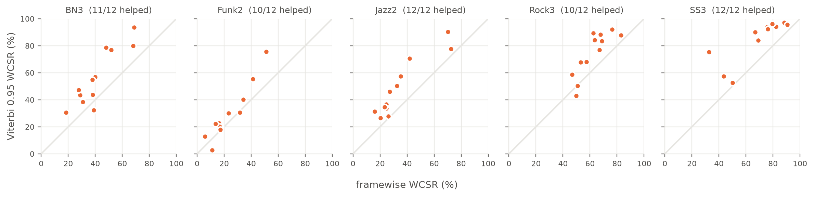
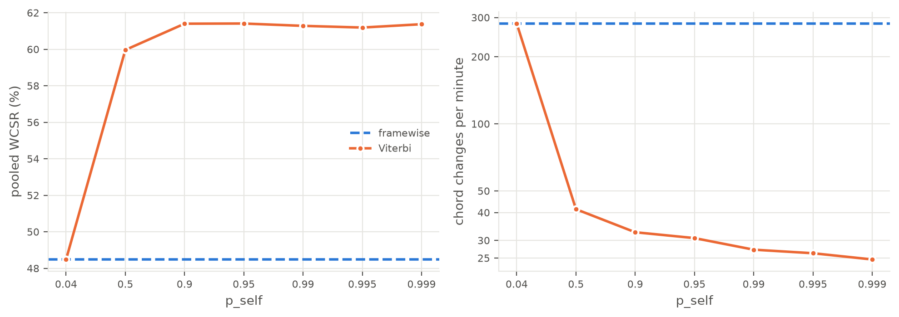
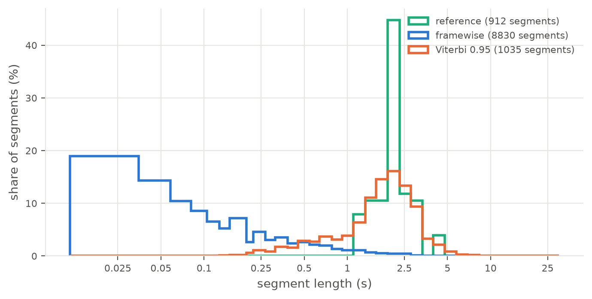
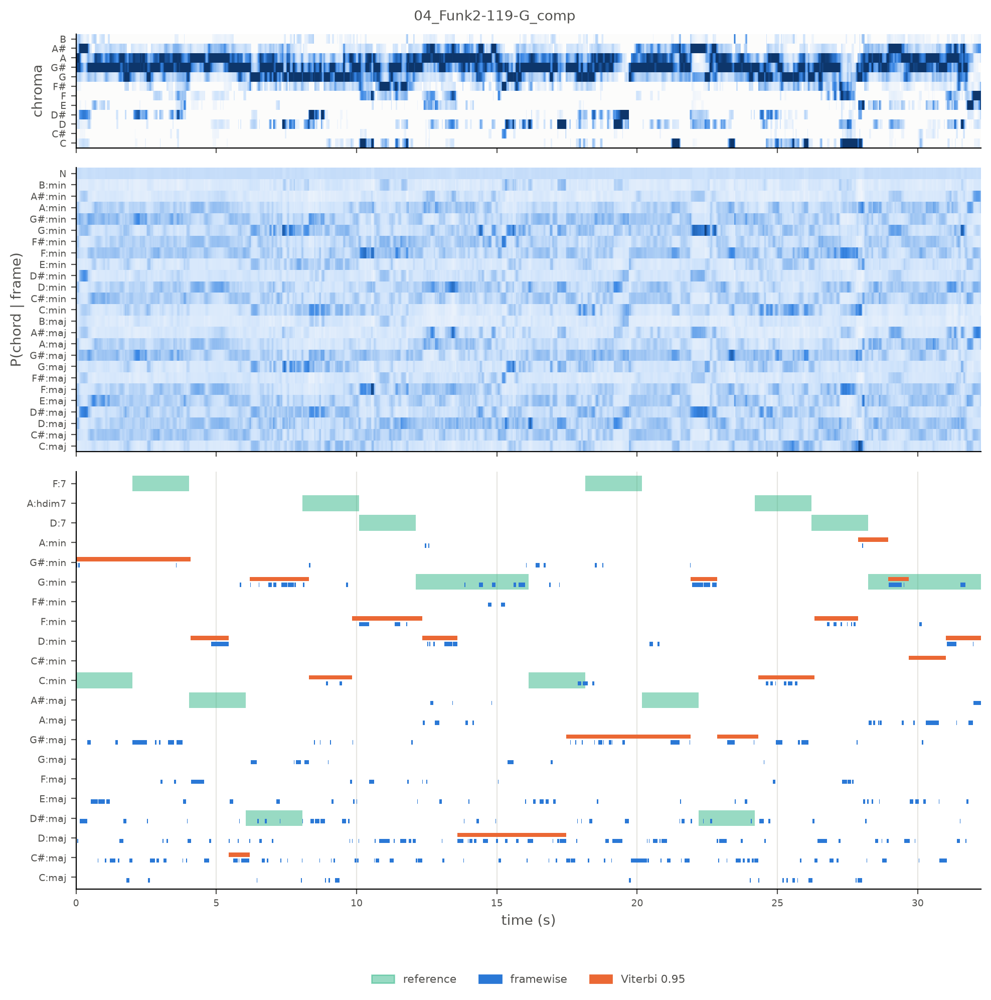
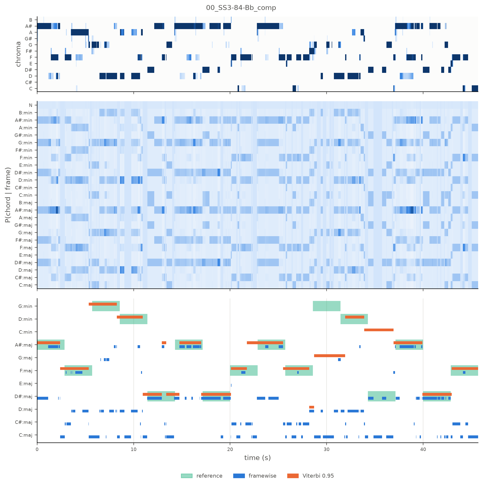
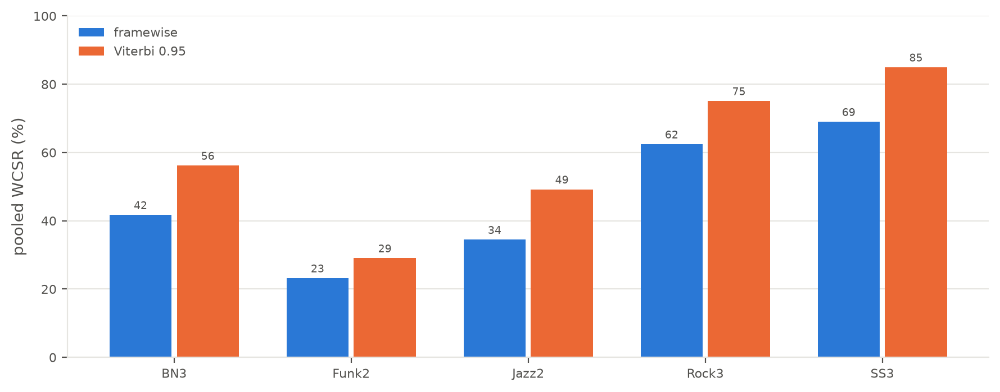

# V0: does Viterbi smoothing beat frame-by-frame chord recognition?

**Answer: yes, clearly, but it cannot fix wrong evidence.** The features, the 25 maj/min/N chords
and the songs are held fixed. On that setup, an HMM (Viterbi) decoding of the frame posteriors
raises the duration-weighted chord score on the untouched test split from **41.8% to 53.7%**,
compared with taking each frame's best chord. It does this by removing flicker: framewise changes
chord 288 times a minute and Viterbi 31 times (on val, the reference changes about 26 times a minute). Where the frame evidence
itself points to the wrong chord, Viterbi outputs a stable wrong chord in place of a flickering one.

| Test split, run once (60 takes) | WCSR | Chord changes per minute |
|---|---:|---:|
| Framewise (argmax per frame) | 41.8 % | 288 |
| **Viterbi, p_self 0.95** | **53.7 %** | **31** |



*Each dot is a val take. Above the diagonal, Viterbi helps, which it does on 55 of the 60 takes.*

- [Question](#question)
- [Setup](#setup)
- [How the evaluation avoids leakage](#how-the-evaluation-avoids-leakage)
- [Choice on val](#choice-on-val)
- [Test, run once](#test-run-once)
- [Findings (all from val)](#findings-all-from-val)
- [Limitations](#limitations)
- [What the next version should look at](#what-the-next-version-should-look-at)
- [Reproduce](#reproduce)

## Question

V0 is the baseline of a series of controlled comparisons, and it asks one thing. A chord
recognizer gives a probability for every chord at every 23 ms frame. Does it help to decode the
whole sequence with an HMM that has a single "stay on the same chord" probability (p_self),
compared with picking the best chord in each frame independently? Both systems read the same
posteriors, so the decoder is the only difference.

## Setup

| | |
|---|---|
| Data | GuitarSet comp (accompaniment) takes, mono mic: 180 takes, 6 players, 5 styles |
| Split | by song group (style + progression), seed 0: 60 train, 60 val and 60 test takes, with every take of a progression in one split |
| Audio | 22050 Hz mono, harmonic part only (HPSS margin 4) |
| Features | `chroma_cqt`, hop 512 (23.2 ms), tuning estimated per file, per-frame max norm |
| Emission (posterior) | 24 binary triad templates + N; P(chord \| frame) = softmax(templates @ chroma), beta 1 |
| Decoders | framewise argmax; `viterbi_discriminative` with `transition_loop(25, p_self)` |
| Metric | `mir_eval.chord.majmin`, duration-weighted (WCSR), pooled over the split |
| Code | config `configs/v0.yaml`; results produced at commit `b2b1d34`; this report is tagged `v0` |

V0 has no trained parameters. The templates are written by hand, so the train split is not used
yet, and p_self is the only value chosen, on val.

**Label policy.** V0 outputs only major triads, minor triads and N. With majmin, a reference `C:7`
is compared as `C:maj` ("reduced"). `B:hdim7`, `sus` and `X` are left out of the score
("excluded"). So a V0 score answers "did it find the right triad?". On val, 10.0% of the scored
time is reduced and 4.8% of all time is excluded. On test the figures are 17.8% and 8.2% (table
below). The details are in the README's [label policy](../README.md#label-policy).

## How the evaluation avoids leakage

The test score is an honest estimate only while no decision has been made by looking at test. So
every version follows one rule: **test is scored, never inspected.**

- **Val** is where p_self is chosen. Every figure, every per-take or per-style breakdown and every
  "why does it fail" question in this report uses val takes, and so does every idea for the next
  version.
- **Test** is run once with the frozen code and the chosen p_self. It appears only as the pooled
  numbers in the test table. No test take is plotted or examined, and test errors are not
  explained.

The rule is enforced in code as well. `report.v0_figures` refuses a test take and writes only to
`figures/v0/val/`. If a test result had led to a change, test would have become a second
validation set, and its score would be optimistic by an amount nobody could measure.

## Choice on val



| System | val WCSR | changes / min |
|---|---|---|
| framewise | 48.5 % | 282 |
| Viterbi 0.04 | 48.5 % | 282 |
| Viterbi 0.5 | 60.0 % | 41 |
| Viterbi 0.9 | 61.4 % | 33 |
| **Viterbi 0.95** (chosen) | 61.4 % | 31 |
| Viterbi 0.99 | 61.3 % | 27 |
| Viterbi 0.995 | 61.2 % | 26 |
| Viterbi 0.999 | 61.4 % | 25 |

- p_self 0.95 has the best pooled WCSR: 61.409%, against 61.400% at 0.9 and 61.372% at 0.999. The
  gap is 0.01 points, so the choice really means "anywhere on the plateau".
- At p_self 0.04 = 1/25 the transition matrix is uniform, and Viterbi gives exactly the framewise
  result. This checks that the two decoders read the same posteriors, and the tests check it too.
- Most of the gain is already there at 0.5. Above 0.9, raising p_self keeps removing changes
  (33 to 25 per minute) without moving the score.

## Test, run once

| System | test WCSR | changes / min | takes improved | reduced | excluded |
|---|---|---|---|---|---|
| framewise | 41.8 % | 288 |  | 17.8 % | 8.2 % |
| Viterbi 0.95 | 53.7 % | 31 | 45 / 60 | 17.8 % | 8.2 % |

The gain on test (+11.8 points) is close to the gain on val (+12.9). Both systems score lower on
test than on val, and test has more chords richer than triads: 17.8% of its scored time is
reduced, against 10.0% on val. This is reported, not investigated. Following the rule above,
test is not analysed any further.

## Findings (all from val)

**1. Smoothing is the whole gain, and its strength hardly matters.** Any real self-transition
helps. From p_self 0.9 to 0.999, val WCSR stays between 61.2% and 61.4%. Viterbi improves 55 of
the 60 val takes, with a median gain of +12.2 points.

**2. Viterbi gives chord lengths like the reference.** On val, framewise produces 8830 segments,
against 912 in the reference and 1035 from Viterbi. About 19% of framewise segments are a single
23 ms frame. Reference segments last about 1.1 to 5 s, and Viterbi's peak at the same place,
around 2 s. Viterbi also has a tail of 0.2 to 1 s segments that the reference never has.



**3. The emission is the bottleneck.** Framewise is right on only 48.5% of val time, so the
template-on-chroma evidence is wrong about half of the time, and smoothing cannot repair that.
The worst val take, `04_Funk2-119-G`, goes from 11.2% to 2.6%. Viterbi holds wrong chords for
1 to 4.5 s at a time, and they usually share notes with the right one: D:maj for G:min, G#:maj
for F:7, F:min for D:7. Throughout the take, G# and A dominate the chroma, which does not fit a
G-minor progression. *(Not yet explained: a tuning or pitch problem in the features is one
candidate, to be checked on val.)*



For contrast, `00_SS3-84-Bb` gets the biggest gain on val, from 32.7% to 75.3%. Viterbi follows
the reference segments with boundaries 0.3 to 1 s early. Its remaining errors are a major/minor
swap (G:maj for G:min) and a relative minor (C:min for D#:maj).



**4. Style matters more than the decoder.**



| Style | framewise | Viterbi 0.95 |
|---|---|---|
| BN | 41.7 % | 56.2 % |
| Funk | 23.2 % | 29.1 % |
| Jazz | 34.5 % | 49.2 % |
| Rock | 62.5 % | 75.1 % |
| SS | 69.0 % | 85.0 % |

With Viterbi, the styles range from 29.1% to 85.0%, a spread of 56 points. The decoder adds about
13 points on average. On val, all of the reduced and excluded time sits in Funk and Jazz, the two
weakest styles, where the lead sheets use 7th and hdim7 chords that a triad template matches only
in part. *(Hypothesis, to be tested on val.)*

## Limitations

- **Triads only.** Between 10.0% (val) and 17.8% (test) of scored time is a richer chord compared
  as its triad. Another 4.8% to 8.2% (sus, hdim7, X) is excluded from the score.
- **Nothing is learned.** The templates are binary and hand-made, beta = 1 is not tuned, and the
  transition matrix treats every chord change as equally likely, with no notion of key or harmony.
  p_self is the only chosen value.
- **Offline decoding.** Viterbi needs the whole take before it outputs anything, while framewise
  works frame by frame. A real-time tracker needs online or fixed-lag decoding.
- **One dataset.** GuitarSet comp takes only: solo guitar, 6 players, 60 takes per split.

## What the next version should look at

Each version changes one thing and is compared with the previous one on val. The val evidence
points at the emission, not the decoder:

- **Check the chroma on the weakest val styles** (Funk, Jazz), starting with the G#/A dominance in
  `04_Funk2-119-G` (finding 3).
- **Better emission:** learned or tuned templates and beta (findings 3 and 4).
- **Richer vocabulary:** sevenths, scored with `mir_eval.chord.sevenths` (finding 4).
- **Later:** fixed-lag Viterbi, to measure what real-time output costs, and musically informed
  transitions.

## Reproduce

```bash
python scripts/run_v0.py --split val                       # sweep, choose p_self (0.95)
python scripts/run_v0.py --split test --p-self 0.95        # once
python scripts/plot_v0.py --p-self 0.95 --take 00_SS3-84-Bb_comp --take 04_Funk2-119-G_comp
```

The last command writes the val figures to `figures/v0/val/` and prints the tables of this report
(`report.results_tables("v0")`). Every table above is that output, pasted unchanged. The notebook
`notebooks/V0_figures.ipynb` does the same inline.
