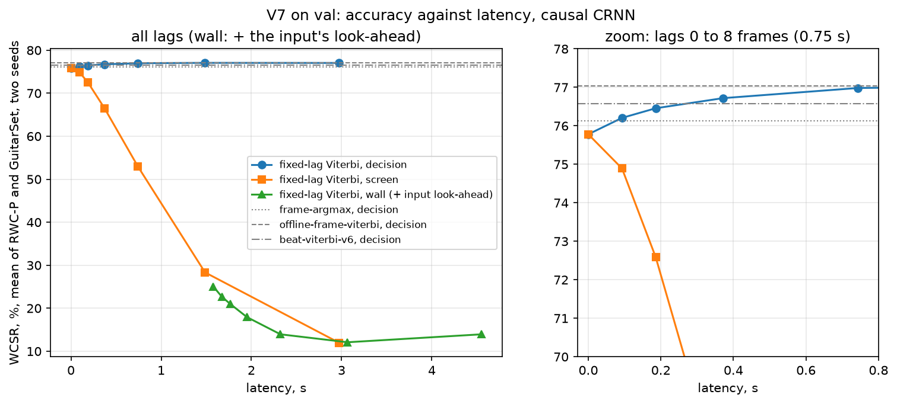

# V7: decoders that only use past frames

**Answer: on a live display, the best decoder for V6's causal CRNN is no decoder at all, and the
input, not the decoder, is what keeps the system from being real time.** V7 keeps V6's causal CRNN
(not retrained) and replaces the whole-song beat Viterbi with decoders that decide on every 93 ms
frame from the frames up to a lag L. Three things come out of val:

1. **Beats are not needed.** Viterbi over frames instead of beats is 0.5 points better (77.04 against
   76.57 % mean WCSR, two seeds), and the network alone per frame (76.14 %) is within the seed noise
   of V6's beat HMM.
2. **Waiting improves each decision a little but costs much more on screen.** A fixed-lag Viterbi
   gains 0.6 points over the network alone at 0.37 s of lag and reaches the offline score at about
   1.5 s. But a display that waits L frames shows every chord L frames late: on screen it falls
   1.25 points below the network alone at 93 ms and 9.6 points below at 0.37 s. The best screen score is the network alone at lag 0 (76.14 %),
   at the price of 44 to 48 chord changes per minute against 28 to 31 in the reference.
3. **The input already looks about 1.6 s ahead** (centred CNN window, centred CQT, harmonic
   separation). Counted as delay, it brings every system down to about 25 % on screen. A causal
   front end (V7.1) is what real time needs next.

| Val, mean WCSR of RWC-P and GuitarSet, % | lag | seed 0 | seed 1 | mean | changes / min |
|---|---:|---:|---:|---:|---:|
| `beat-viterbi-v6` (V6 causal + beat HMM, p_self 0.4) | song | 76.08 | 77.06 | 76.57 | 28 |
| `offline-frame-viterbi` (p_self 0.98) | song | 76.24 | 77.85 | **77.04** | 30 |
| `frame-argmax` (the network alone) | 0 | 75.25 | 77.02 | 76.14 | 46 |
| `forward-filter` (p_self 0.1) | 0 | 75.04 | 76.93 | 75.98 | 45 |
| `fixed-lag-viterbi`, decision (p_self 0.95) | 4 (0.37 s) | 75.99 | 77.45 | 76.72 | 35 |
| `fixed-lag-viterbi`, screen (p_self 0.95) | 4 (0.37 s) | 66.07 | 66.99 | 66.53 | 35 |

| Test, run once, causal seed 1, frozen choices | RWC-P | GuitarSet | mean |
|---|---:|---:|---:|
| `beat-viterbi-v6` (p_self 0.4) | 79.55 | 71.82 | 75.69 |
| `offline-frame-viterbi` (p_self 0.98) | **80.09** | **72.41** | **76.25** |
| `frame-argmax`, lag 0 (the live operating point) | 79.55 | 71.41 | 75.48 |
| `fixed-lag-viterbi`, lag 4, decision (p_self 0.95) | 79.67 | 72.14 | 75.90 |

- [Question](#question)
- [Setup](#setup)
- [How the evaluation avoids leakage](#how-the-evaluation-avoids-leakage)
- [How far V6's causal system looks ahead](#how-far-v6s-causal-system-looks-ahead)
- [Results on val](#results-on-val)
- [Findings (all from val)](#findings-all-from-val)
- [Test](#test)
- [Limitations](#limitations)
- [What the next version should look at](#what-the-next-version-should-look-at)
- [Reproduce](#reproduce)

## Question

V6 found the causal CRNN within the seed noise of the bidirectional one once V5's HMM decoder is
added, but that decoder is Viterbi over the beats of the whole song: no chord is final before the
song ends. V7 asks what is lost when the decoder may only use the past, as a function of how long it
waits (its lag), and measures how much of the rest of the pipeline still reads the future.

## Setup

Everything is V6's causal model (`results/v6/causal_seed0` and `causal_seed1`, `configs/v6.yaml`)
except the decoder. Nothing is trained.

    posteriors  V6 causal CRNN, whole song in one GRU pass (streaming_crnn shows a frame-by-frame
                loop gives the same numbers)
    step        one CRNN frame, 93 ms (hop 2,048 at 22,050 Hz); no beat tracker
    evidence    P(chord | frame) / P(chord), the training prior divided out, as V4 to V6
    A           p_self I + (1 - p_self) Q, Q the Billboard change prior (V3), p_self per frame

Five systems (`scripts/run_v7.py`, decoders in `src/chordtracker/online_hmm.py`):

| System | What it does | Decision for frame t is made at | Lag |
|---|---|---|---|
| `beat-viterbi-v6` | V6's decoder: posteriors pooled per beat, Viterbi over the song (reference) | end of song | song |
| `frame-argmax` | the most likely chord of every frame, the network alone | t | 0 |
| `forward-filter` | argmax of P(chord at t given frames 0..t), the HMM forward pass | t | 0 |
| `fixed-lag-viterbi` | the best path over frames 0..t + L, read at t | t + L | L frames |
| `offline-frame-viterbi` | Viterbi over all frames of the song (reference) | end of song | song |

Symbols: t is a frame index, L the lag in frames (grid 0, 1, 2, 4, 8, 16, 32, i.e. 0 to 3.0 s),
p_self the probability of staying on the same chord one more frame (a chord then lasts
1 / (1 - p_self) frames on average). `fixed-lag-viterbi` at L = 0 is the max-product twin of
`forward-filter`, and as L grows it becomes `offline-frame-viterbi` decision for decision (a test
checks this against librosa).

Three scores per system, all mir_eval majmin WCSR pooled per set (sets never pooled, mean of the two):

    decision  the chord decided for frame t, placed at frame t: how good the decision is, however late
    screen    what a live display shows at frame t: the decision for frame t - L ("N" before frame L)
    wall      screen shifted further by the input's own look-ahead (17 frames, next section)

- **Correction 1.** The first val run used a p_self grid from 0.5 up; at lags 0 and 1 the best value
  was the grid's lower edge. 0.1 and 0.3 were added and val was rerun (the only correction).
- **Run-to-run noise.** As in V6, two seeds; a difference counts as a gain only if both seeds of one
  system beat both seeds of the other. V6's two causal seeds are a point apart.
- **Reproduction check.** `beat-viterbi-v6` recomputed by run_v7 gives exactly V6's numbers
  (76.09 and 77.06 % at each seed's best p_self).

## How the evaluation avoids leakage

Same rule as V0 to V6: **test is scored once, never inspected.** No weights changed. Every choice
(decoder, p_self per system and per lag, lag grid, seed) was made on val and written into
`configs/v7.yaml` (`frozen`) before `run_v7.py --split test --freeze` ran once, and only its summary
numbers were read. As planned, the test run scores the whole frozen lag curve in one pass, since the
curve is the version's result.

## How far V6's causal system looks ahead

V6's causal model only has a forward GRU. Six other parts read the future (code at tag v6):

| Part | Where | Looks ahead by |
|---|---|---|
| Viterbi over beats | `acoustic_hmm.decode` | the whole song (backtrace from the last beat) |
| Beat tracker | `beats.beat_frames` (librosa `beat_track`, dynamic programming) | the whole song |
| Level and tuning | `log_compress` (the take's 99th percentile), `estimate_tuning` per file | the whole song |
| CNN window | `data_v5.patch`: 15 frames centred on the frame it labels | 7 frames = 0.65 s |
| CQT kernel | `librosa.cqt` is centred; half the kernel of C1, the lowest bin the network sees unshifted | 0.53 s |
| Harmonic part | `librosa.effects.harmonic`: STFT 2,048 + median filter over 31 frames at hop 512 | 0.39 s |

V7 removes the first two. The last three add up to 1.57 s, 17 frames (`front_end_lookahead_frames`):
the posterior of frame t can only be computed once the audio up to about t + 1.6 s has arrived. The
level and tuning need the whole song and are not counted in `wall`; a live system would estimate them
from what it has heard so far.

## Results on val

Decision and screen WCSR of `fixed-lag-viterbi`, mean of RWC-P and GuitarSet, both seeds, p_self
chosen per lag (the same p_self wins on decision and on screen at every lag):

| lag | s | p_self | decision, seed 0 / 1 | decision, mean | screen, mean | wall, mean | changes / min |
|---:|---:|---:|---|---:|---:|---:|---:|
| 0 | 0.00 | 0.1 | 74.87 / 76.69 | 75.78 | 75.78 | 25.02 | 48 |
| 1 | 0.09 | 0.3 | 75.36 / 77.05 | 76.21 | 74.89 | 22.69 | 39 |
| 2 | 0.19 | 0.7 | 75.66 / 77.25 | 76.46 | 72.59 | 20.96 | 36 |
| 4 | 0.37 | 0.95 | 75.99 / 77.45 | 76.72 | 66.53 | 17.91 | 35 |
| 8 | 0.74 | 0.98 | 76.27 / 77.69 | 76.98 | 52.93 | 13.94 | 32 |
| 16 | 1.49 | 0.98 | 76.28 / 77.84 | 77.06 | 28.34 | 12.09 | 30 |
| 32 | 2.97 | 0.98 | 76.24 / 77.85 | 77.04 | 11.97 | 13.94 | 30 |
| `frame-argmax` | 0 | | 75.25 / 77.02 | 76.14 | 76.14 | 25.00 | 46 |
| `forward-filter` | 0 | 0.1 | 75.04 / 76.93 | 75.98 | 75.98 | 25.06 | 45 |
| `offline-frame-viterbi` | song | 0.98 | 76.24 / 77.85 | 77.04 | | | 30 |
| `beat-viterbi-v6` | song | 0.4 | 76.08 / 77.06 | 76.57 | | | 28 |

Changes per minute: mean over the takes of both sets and both seeds. The references have 31 (RWC-P)
and 28 (GuitarSet) chord segments per minute.



`forward-filter` at lag 0 by p_self (mean of the two seeds): 0.1: 75.98 %, 0.5: 75.54, 0.9: 74.35,
0.98: 73.31. The stickier the chain, the worse the decision without look-ahead.

**Speed** (`scripts/v7_speed.py`, Mac CPU, RWC-P val song 3, 2,062 frames): the frame-by-frame CRNN
step plus a `fixed-lag-viterbi` step at L = 32 takes 1.70 ms per frame on average (99th percentile
2.63 ms) against 92.9 ms between frames, a real-time factor of 0.02. The CQT is not timed.

## Findings (all from val)

**1. Frames do as well as beats, or better.** `offline-frame-viterbi` beats `beat-viterbi-v6` with
each seed (+0.16 and +0.79 points, 77.04 against 76.57 % mean); the two-seed rule is not met (seed 0 of
the frame decoder is below seed 1 of the beat decoder), so this is a tie with a lean towards frames.
The network alone per frame, 76.14 %, is 0.8 points above V6's network alone per beat (75.34 %) and
within the noise of the beat HMM. The beat tracker, which no causal system can use as it is, is not
needed.

**2. With only the past, the HMM does not beat the network alone.** At lag 0, `forward-filter`
(75.98 %) and `fixed-lag-viterbi` (75.78 %) are both below `frame-argmax` (76.14 %), and both prefer
the least sticky chain on the grid. Without look-ahead a transition prior can only hold the old chord
a little longer after the evidence has moved on; the GRU already does the smoothing that past frames
allow. The HMM still barely changes the flicker at lag 0: 45 chord changes per minute with the filter, 46 without.

**3. Waiting improves the decision, and the curve is short.** `fixed-lag-viterbi` gains 0.07 points
over the network alone at 1 frame, 0.58 at 4 frames (0.37 s) and 0.84 at 8 frames, and reaches the
offline score at 16 frames (1.5 s). The smallest lag within 0.5 points of `offline-frame-viterbi` is
4 frames. Each step also removes flicker: 46 changes per minute at lag 0, 35 at lag 4, 30 offline.

**4. On screen, waiting never pays.** A display that waits L frames is wrong for L frames after every
chord change. With a change every 2 s or so, one frame of delay already puts the screen 1.25 points
below the network alone, more than the whole decision gain of any lag, and 4 frames put it 9.6
points below (66.53 %). The best live display is
`frame-argmax` at lag 0, 76.14 % on screen. What the HMM buys a live display is fewer flickers (the
lag-1 Viterbi shows 39 changes per minute instead of 46, for 1.25 points), not accuracy.

**5. The input's look-ahead dominates everything.** Counting the 1.6 s the CRNN's input already reads
past each frame, every lag-0 system drops to about 25 % on screen (`wall`), which is the cost of
showing every chord 1.6 s late. No decoder can win that back: it has to come from a front end that
does not read the future, and a network trained on it (V7.1).

**6. Speed is not a constraint.** 1.7 ms per frame for CRNN and decoder, 2 % of the frame budget.

**Freeze.** The live operating point is `frame-argmax` at lag 0 (best two-seed screen WCSR). The
decision curve is frozen as measured, with p_self per lag from val (`configs/v7.yaml`, `frozen`); its
recommended point for an application that can wait is lag 4 (0.37 s). Seed 1, the better causal seed
on val, as in V6.

## Test

Run once, after the freeze, with `results/v6/causal_seed1` and the frozen p_self of every system and
lag. Decision WCSR, mean of the two sets (RWC-P, GuitarSet):

| | lag | decision | screen | wall |
|---|---:|---:|---:|---:|
| `beat-viterbi-v6` | song | 75.69 (79.55, 71.82) | | |
| `offline-frame-viterbi` | song | 76.25 (80.09, 72.41) | | |
| `frame-argmax` | 0 | 75.48 (79.55, 71.41) | 75.48 | 27.69 |
| `forward-filter` | 0 | 75.39 | 75.39 | 27.66 |
| `fixed-lag-viterbi` | 0 | 75.21 | 75.21 | 27.60 |
| | 1 | 75.60 | 74.43 | 25.53 |
| | 2 | 75.74 | 72.20 | 23.76 |
| | 4 | 75.90 (79.67, 72.14) | 66.56 | 21.11 |
| | 8 | 76.10 | 54.01 | 17.34 |
| | 16 | 76.17 | 30.65 | 13.97 |
| | 32 | 76.25 | 14.17 | 12.95 |

The test curve has the shape of the val curve: frames at least as good as beats (+0.56), the HMM at
lag 0 below the network alone, the decision reaching the offline score by 32 frames, and the screen
score falling with every frame of lag. The live operating point scores 75.48 % (val seed 1: 77.02 %).

## Limitations

- **The screen score models one kind of display**: it shows the decision for frame t - L at frame t.
  A display could also show the lag-0 guess at once and correct it L frames later; that is not scored.
- **`wall` shifts the output of a model that saw the future.** A CRNN trained on a causal front end
  would guess the present from the past instead of showing the past late, and should score well
  above 25 %. `wall` is the cost of the current input, not a forecast for V7.1.
- **The 1.6 s is estimated from the code** (window, kernel and filter lengths), not measured end to
  end on audio, and the whole-song level and tuning are left out of it.
- **Grid edges.** The best p_self is the grid's lowest value (0.1) at lag 0 and its highest (0.98)
  from lag 8 up and offline; the lag-0 trend points to the network alone, which is scored, and the
  long-lag edge could hide a few tenths for `offline-frame-viterbi`.
- **Two seeds**, the same 24 classes and the same data as V5 and V6.

## What the next version should look at

- **V7.1, a causal front end** (one change, make the input causal): a past-only 15-frame window,
  the CQT's low kernels shortened or made causal, the harmonic separation dropped or causal, and a
  running level and tuning; then the causal CRNN retrained on it. It answers how much of the 1.6 s
  the network can do without, and gives the first honest wall-clock score.
- **Flicker control on the display side**: a minimum display duration or hysteresis on the lag-0
  output, scored on screen WCSR and changes per minute, since the HMM's only live benefit is fewer
  changes.
- **The N class and sevenths** remain open on top of whichever live system wins.

## Reproduce

```bash
PYTHONPATH=src python scripts/run_v7.py --split val --run results/v6/causal_seed0     # ~4 min each
PYTHONPATH=src python scripts/run_v7.py --split val --run results/v6/causal_seed1
PYTHONPATH=src python scripts/v7_plot.py results/v7/causal_seed0 results/v7/causal_seed1
PYTHONPATH=src python scripts/v7_speed.py results/v6/causal_seed1
PYTHONPATH=src python scripts/run_v7.py --split test --freeze --run results/v6/causal_seed1   # once
```
