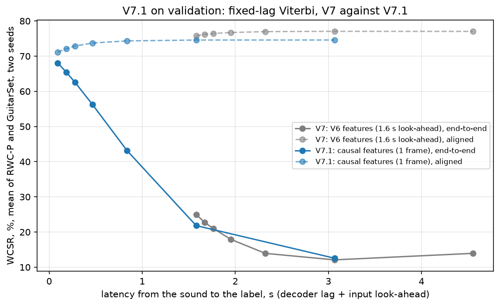

# V7.1: input features that use no future audio

## Question

By design, only the GRU of V6's causal CRNN is causal: its input features are V5's, which are centred
on each frame, so the features for frame t need about 1.6 s of audio after t (reports/v7.md, "How far
V6's causal system looks ahead"). Counting that delay, every V7 decoder drops to about 25 %
end-to-end WCSR. V7.1 asks: **how accurate is the causal CRNN when its input for frame t uses only
audio up to t?** One change, the input; the CRNN architecture, training and decoders stay V6's and V7's.

## Summary of the results

Making the features causal costs about 4.6 points of accuracy per label and gains about 43 points
once delay is counted: the system is now usable in real time, at about 68 % end-to-end WCSR instead
of 25 %. Three results on validation (two seeds each):

1. **Causal features, retrained CRNN.** The network alone scores 71.50 % aligned WCSR (V7: 76.14 %)
   and 68.38 % end-to-end WCSR (V7: 25.00 %). With the whole song (offline frame Viterbi) it scores
   74.60 % (V7: 77.04 %). The only look-ahead left is one frame (93 ms) of the harmonic separation.
2. **The loss sits right after chord changes.** In the first 0.5 s after a reference chord change the
   network alone is right on 45 to 52 % of frames (V7: 63 to 75 %); in the rest of the song it is
   about as good as V7 (RWC-P 80 % in both, GuitarSet 75 to 76 % against 73 to 76 %). A system that
   cannot hear ahead has to hear a new chord before it can name it.
3. **The decoders behave as in V7.** At lag 0 the HMM does not beat the network alone; waiting
   improves each label (aligned WCSR +2.8 points at 8 frames) but every frame of waiting costs more in
   end-to-end WCSR. The network alone flickers: about 84 chord changes per minute, against 28 to 31
   chord segments per minute in the reference.

| Validation, WCSR %, mean of RWC-P and GuitarSet | seed 0 | seed 1 | mean |
|---|---:|---:|---:|
| V7 (V6 features), network alone, aligned | 75.25 | 77.02 | 76.14 |
| V7 (V6 features), network alone, end-to-end | 24.85 | 25.15 | 25.00 |
| **V7.1, network alone, aligned** | 71.45 | 71.56 | **71.50** |
| **V7.1, network alone, end-to-end** | 68.33 | 68.43 | **68.38** |
| V7.1, offline frame Viterbi (p_self 0.98), aligned | 74.55 | 74.65 | 74.60 |

| Test, run once, seed 1, frozen choices | RWC-P | GuitarSet | mean |
|---|---:|---:|---:|
| network alone (frame-argmax), aligned | 73.70 | 68.22 | 70.96 |
| **network alone (frame-argmax), end-to-end** | 70.27 | 66.06 | **68.16** |
| offline-frame-viterbi, aligned | 76.10 | 70.42 | 73.26 |

V7's frozen test run (V6 features, causal seed 1): network alone 75.48 % aligned, 27.69 % end-to-end;
offline frame Viterbi 76.25 %.

- [Setup](#setup)
- [How the evaluation avoids leakage](#how-the-evaluation-avoids-leakage)
- [The causal features](#the-causal-features)
- [Results on validation](#results-on-validation)
- [Findings (all from validation)](#findings-all-from-validation)
- [Test](#test)
- [Limitations](#limitations)
- [What the next version should look at](#what-the-next-version-should-look-at)
- [Reproduce](#reproduce)

## Setup

Everything is V6's causal CRNN and V7's decoders, except the input features:

    features    features_v7_1: causal harmonic part, CQT with every bin delayed so its kernel ends at its
                frame, running level, tuning from the first 10 s; cache data/processed/v7_1_logcqt_median9/
    window      15 frames ending at the frame (t - 14 .. t) instead of centred (t - 7 .. t + 7), data_v7_1
    network     model_v6.ChordCRNN with a forward GRU, retrained from scratch (train_v7_1), V6's settings:
                128-frame excerpts, one pitch shift per excerpt, Adam 1e-3, 8 excerpts per step, early
                stopping on validation frame accuracy (patience 5), seeds 0 and 1
    decoders    V7's frame-level systems (frame-argmax, forward-filter, fixed-lag-viterbi at lags 0 to
                32 frames, offline-frame-viterbi); beat-viterbi-v6 is left out (its beat tracker reads
                the whole song)
    scores      V7's aligned, on-time and end-to-end WCSR; the input's look-ahead is 1 frame

The three scores, as in reports/v7.md: **aligned** compares each label with the reference chord at the
frame it describes; **on-time** with the chord playing when the decoder outputs it (t + L, for a lag
of L frames); **end-to-end** with the chord playing when the label could exist from audio arriving as it
is played (t + L + the input's look-ahead). For V7 the look-ahead is 17 frames, for V7.1 one frame.

- **Correction 1.** The plan's harmonic median spans 31 past STFT frames, as V0 to V7. A new note only
  counts as harmonic once it fills half of them, about 0.37 s. The first run (31 frames) was replaced
  by a 9-frame median (about 0.1 s): better with both seeds (below). The only correction.
- **Run-to-run noise.** Two seeds per setting; a difference counts as a gain only if both seeds of one
  setting beat both seeds of the other.
- **Tests.** `tests/test_features_v7_1.py` checks that no feature column reads the future: features
  computed on the audio cut at a time T equal the full song's for every column the cut allows, on
  synthetic audio (every run) and on 6 real training songs (`pytest -m slow`). It also shows the same
  check fails for V5's centred CQT. `tests/test_data_v7_1.py` checks the window, that the CRNN's output
  for a frame never reads a later column, and that feeding the columns one at a time
  (`streaming_v7_1.CausalStreamingCRNN`) gives the whole-song posteriors.

## How the evaluation avoids leakage

Same rule as V0 to V7: **test is scored once, never inspected.** The weights see RWC-P train and
GuitarSet comp train only. Every choice (tuning rule, median width, seed, p_self per system and lag)
was made on training songs or on validation and written into `configs/v7_1.yaml` (`frozen`) before
`run_v7_1.py --split test --freeze` ran once; only its summary numbers were read.

## The causal features

How far each part of the input reads past its frame:

| Part | V5 to V7 | V7.1 |
|---|---|---|
| CNN window | 15 frames centred: 7 frames (0.65 s) | 15 frames ending at the frame: 0 |
| CQT kernels | centred: half the kernel (C1: 0.53 s) | each bin delayed by half its kernel, rounded up to whole frames (C1 6 frames, A2 2, A3 and above 1): 0 |
| Harmonic part | median over 31 STFT frames centred: 0.39 s | median over the past 9 STFT frames; the STFT window still reaches 2,048 samples ahead: 1 frame (93 ms) |
| Level | the whole song's 99th percentile | the 99th percentile of frames 0 .. t |
| Tuning | estimated on the whole file | A440 until 10 s of audio are in, then the estimate from those 10 s |

- **Tuning (step 1).** `scripts/v7_1_tuning.py` measured the whole-file tuning of the 120 training
  songs: 77 % within 10 cents of A440 (RWC-P 98 %, GuitarSet 55 %, up to 25 cents). The rule fixed
  before measuring (95 % within 10 cents for a fixed A440) was not met, so the tuning is estimated on
  the first 10 s.
- **librosa's CQT reads further than its kernels.** By default librosa sparsifies the CQT kernels
  (sparsity 0.01), which spreads each octave's kernels over its whole FFT frame, about twice the
  kernel: C1 would read 1.5 s ahead, not 0.53 s. The prefix test caught it; V7.1 uses the exact kernels
  (sparsity 0), whose reach is at most half their length, so the bin delays hold.
- **What the network hears late.** Nothing waits, but information arrives late: low notes by up to
  6 frames, every bin by at least 1 (the rounding), and new notes by the harmonic median (about 0.1 s
  with 9 frames). The figure `V7.1 causal pipeline frame by frame` (project diagrams) shows it frame
  by frame.

## Results on validation

**Training** (best epoch by mean validation frame accuracy):

| run | best epoch / run | RWC-P | GuitarSet | minutes |
|---|---:|---:|---:|---:|
| median 31, seed 0 | 10 / 15 | 72.31 % | 65.85 % | 17 |
| median 31, seed 1 | 18 / 23 | 72.92 % | 66.38 % | 26 |
| median 9, seed 0 | 10 / 15 | 72.70 % | 68.37 % | 17 |
| median 9, seed 1 | 8 / 13 | 72.04 % | 69.54 % | 15 |

**Correction 1**, WCSR %, mean of RWC-P and GuitarSet, seed 0 / seed 1:

| | median 31 | median 9 |
|---|---:|---:|
| network alone, aligned | 70.11 / 70.73 | 71.45 / 71.56 |
| network alone, end-to-end | 67.13 / 67.68 | 68.33 / 68.43 |
| offline frame Viterbi, aligned | 73.24 / 73.93 | 74.55 / 74.65 |

Both median-9 seeds beat both median-31 seeds on all three rows; the gain is mostly on GuitarSet.

**Decoders** (median 9, two-seed means, p_self chosen per lag on each score):

| lag | s | aligned | on-time | end-to-end | p_self (on-time) |
|---:|---:|---:|---:|---:|---:|
| `frame-argmax` | 0 | 71.50 | 71.50 | 68.38 | |
| `forward-filter` | 0 | 71.37 | 71.37 | 68.26 | 0.1 |
| `fixed-lag-viterbi` 0 | 0.00 | 71.16 | 71.16 | 68.06 | 0.1 |
| 1 | 0.09 | 72.14 | 68.90 | 65.39 | 0.3 |
| 2 | 0.19 | 72.89 | 66.14 | 62.54 | 0.7 |
| 4 | 0.37 | 73.74 | 59.88 | 56.28 | 0.98 |
| 8 | 0.74 | 74.34 | 46.51 | 43.18 | 0.98 |
| 16 | 1.49 | 74.59 | 23.88 | 21.84 | 0.98 |
| `offline-frame-viterbi` | song | 74.60 | | | 0.98 |

Per set, seed 0 / seed 1: network alone RWC-P 71.99 / 71.17 %, GuitarSet 70.91 / 71.94 % (V7: 77.17 /
77.72 and 73.33 / 76.32); offline frame Viterbi RWC-P 74.64 / 73.37 %, GuitarSet 74.47 / 75.92 % (V7:
77.08 / 77.94 and 75.39 / 77.75).



**Where the accuracy goes** (`scripts/v7_1_breakdown.py`): frame accuracy of the network alone, seed 0
/ seed 1.

| | first 0.5 s after a chord change | rest of the song | first 5 s of a song | rest of the song |
|---|---:|---:|---:|---:|
| RWC-P, V7 | 72.5 / 74.9 | 79.8 / 80.3 | 72.6 / 73.6 | 78.0 / 79.0 |
| RWC-P, V7.1 median 31 | 50.2 / 51.1 | 80.2 / 80.7 | 64.2 / 65.3 | 72.5 / 73.1 |
| RWC-P, V7.1 median 9 | 52.4 / 50.8 | 80.0 / 79.7 | 67.2 / 68.1 | 72.8 / 72.1 |
| GuitarSet, V7 | 63.4 / 66.9 | 73.2 / 76.0 | 72.8 / 75.1 | 70.7 / 73.8 |
| GuitarSet, V7.1 median 31 | 45.6 / 46.0 | 71.6 / 72.1 | 63.1 / 64.2 | 66.4 / 66.8 |
| GuitarSet, V7.1 median 9 | 44.9 / 46.8 | 75.0 / 75.9 | 67.9 / 67.5 | 68.4 / 69.9 |

**Chord changes per minute** of the network alone (median 9): RWC-P 87 and 92, GuitarSet 75 and 81;
with the offline frame Viterbi 29 to 32; the references have 31 (RWC-P) and 28 (GuitarSet) segments
per minute.

## Findings (all from validation)

**1. Causal features cost about 4.6 points per label and make the system usable in real time.** The
network alone falls from 76.14 % to 71.50 % aligned WCSR, and the offline frame Viterbi from 77.04 %
to 74.60 %. Counted end to end, the network alone rises from 25.00 % to 68.38 %: V7's labels were
accurate but 1.6 s late, V7.1's are a little less accurate but on time.

**2. The cost is concentrated right after chord changes.** In the first 0.5 s after a change the
network alone is right on about half the frames (V7: about two thirds to three quarters). Elsewhere
V7.1 matches V7 on RWC-P (80 %) and is about as good on GuitarSet (75 to 76 % against 73 to 76 %).
V7's centred window saw 0.65 s of the new chord before labelling its first frame; V7.1 has to hear it
first. This part of the loss comes with causality itself, not with one component.

**3. The harmonic median mattered, but not where expected.** Shortening it from 31 to 9 frames gains
about 1.1 points with both seeds, but the first 0.5 s after a change barely moves (RWC-P 50 to 52 %,
GuitarSet 45 to 47 % either way). The gain is at the start of songs (first 5 s: 3 to 4 points) and on
GuitarSet away from changes (72 to 76 %). A 31-frame median also holds back the first notes of a song
and of every sparse passage, where the median window is mostly silence.

**4. The start of a song is weaker.** In the first 5 s the network alone is 1 to 6 points below the
rest of the song (median 9; V7's first 5 s are not weaker): the running level rests on few frames, the GRU state starts empty, the
low CQT bins are still filling, and the tuning is A440 until 10 s.

**5. The decoders behave as in V7.** At lag 0 the HMM is slightly below the network alone (71.37 and
71.16 against 71.50 %). Waiting helps each label more than in V7: +2.8 points of aligned WCSR at 8
frames (V7: +0.8), and the offline frame Viterbi adds 3.1 points to the network alone (V7: 0.9). The
causal network's own output is less smooth and the HMM has more to fix. But on-time and end-to-end
WCSR fall with every frame of lag, so the best real-time system is still the network alone at lag 0.

**6. The network alone flickers.** About 84 chord changes per minute against 28 to 31 in the
reference. Its WCSR is the best on time, but most of its extra changes are short wrong labels around
chord changes.

**Freeze.** Median 9 (correction 1), seed 1 (the better seed on validation: 71.56 % against 71.45 %
for the network alone), p_self per system and lag by two-seed on-time WCSR (offline: aligned), in
`configs/v7_1.yaml` (`frozen`). The best real-time system is `frame-argmax` at lag 0; the smallest lag
within 0.5 points of `offline-frame-viterbi` (aligned WCSR) is 8 frames (0.74 s).

## Test

Run once, after the freeze, with `results/v7_1/median9_seed1` and the frozen p_self of every system
and lag. WCSR, mean of the two sets:

| | lag | aligned | on-time | end-to-end |
|---|---:|---:|---:|---:|
| `frame-argmax` | 0 | 70.96 (RWC-P 73.70, GuitarSet 68.22) | 70.96 | 68.16 (70.27, 66.06) |
| `forward-filter` | 0 | 70.74 | 70.74 | 67.94 |
| `fixed-lag-viterbi` | 0 | 70.33 | 70.33 | 67.56 |
| | 1 | 71.41 | 68.50 | 65.31 |
| | 2 | 71.93 | 65.78 | 62.48 |
| | 4 | 72.52 | 59.85 | 56.51 |
| | 8 | 73.12 | 47.49 | 44.36 |
| | 16 | 73.27 | 26.31 | 24.34 |
| | 32 | 69.65 | 13.34 | 13.26 |
| `offline-frame-viterbi` | song | 73.26 (76.10, 70.42) | | |

The test curve has the shape of the validation curve. The network alone scores 68.16 % end to end
(V7's frozen run: 27.69 %) and 70.96 % aligned (V7: 75.48 %). Lag 32 was frozen at p_self 0.1, the
best on-time choice on validation, which is why its aligned WCSR is below lag 16.

## Limitations

- **The features are computed on the whole file**, in a way the prefix tests show to be causal; no
  frame-by-frame feature extractor exists yet, and its speed is not measured (the running level, as
  written, recomputes a percentile over all past values each frame).
- **One frame of look-ahead is left**, from the STFT window of the harmonic separation, and every CQT
  bin is delayed by at least one frame by the rounding to whole frames.
- **The first 0.5 s after a change** is where the accuracy goes, and the flicker of the network alone
  (about 84 changes per minute) is not addressed.
- **Two seeds, one correction**, the same 24 classes and data as V5 to V7.

## What the next version should look at

### The target set-up: a short read-ahead and delayed playback

The intended use is a musician playing along with a recording while the chords appear. If the
recording is played back to the musician D frames after the system receives it, the system can
read up to D frames past each frame and still have its label ready when that frame is heard. The
label can even come a little early (a lead time) so the musician sees the next chord before it
sounds. So the real-time constraint is not "no look-ahead" but "look-ahead no larger than the
playback delay":

    L = l + lag       the system's total look-ahead, in frames: l frames of input look-ahead (V7.1: 1)
                      plus the decoder's lag
    D >= L + lead     the playback delay that makes every label arrive on time, plus the lead time

With the playback delayed by D, every label reaches the musician together with the frame it
describes, so the score that matters is **aligned WCSR** at total look-ahead L, and the cost is the
delay D the musician hears between the recording and its original timing. V7.1's on-time and
end-to-end WCSR score the other case, playback with no delay, where every frame of look-ahead
arrives late. The next versions should report aligned WCSR against L and choose D on validation.

V7.1 already gives the decoder half of that curve (input look-ahead 1 frame, validation, two seeds):

| total look-ahead L | s | aligned WCSR | chord changes / min |
|---:|---:|---:|---:|
| 1 (network alone) | 0.09 | 71.50 % | about 84 |
| 2 (fixed-lag Viterbi, lag 1) | 0.19 | 72.14 % | about 51 |
| 3 (lag 2) | 0.28 | 72.89 % | about 43 |
| 5 (lag 4) | 0.46 | 73.74 % | about 37 |
| 9 (lag 8) | 0.84 | 74.34 % | about 34 |
| whole song | | 74.60 % | about 31 |

Two consequences. With a few frames of decoder lag, the fixed-lag Viterbi removes most of the
flicker (about 84 changes per minute down to 51 at lag 1, 43 at lag 2 and 37 at lag 4), so with
delayed playback the HMM becomes useful again. And the other half of the curve, input look-ahead, has not been measured: V7.1's network was
trained with none, and the loss sits in the first 0.5 s after chord changes, where a few frames of
input look-ahead should help most.

### Next steps, in order

1. **Input look-ahead l = 1, 2, 4 frames** (93 to 370 ms). The window of frame t ends at t + l
   instead of t; everything else as V7.1, retrained, two seeds per l. With V7.1 (l = 0 for the
   window) this traces aligned WCSR against the input half of L. Combined with the decoder lags
   above, it gives the full curve over L, and the operating point (l, lag, D) is chosen on
   validation. The cache stays (only the window moves); about 30 min per run.
2. **CQT from C2 instead of F#0, in the same version as step 1's best l** (or as its own row). The
   lowest octave and a half carries little chord information but has the longest kernels: C1 needs
   1.06 s of audio and reaches the network 6 frames late; C2 needs 0.53 s and 3 frames. Starting at
   C2 cuts the low notes' delay in half and shrinks the input. Needs a new cache and a retrain; the
   pitch-shift crop moves up with it.
3. **The decoder under delayed playback.** Choose the decoder and lag by aligned WCSR and changes per
   minute at each L (no retraining). The fixed-lag Viterbi already cuts flicker by half at lag 1 to 2; a
   minimum segment duration on top of it is the cheap alternative if more is needed.
4. **The lead time.** Score aligned WCSR with every label shifted a few frames earlier than its frame
   (0 to 3 frames, 0 to 0.28 s): how much showing the next chord early costs, to set D = L + lead.
5. **A frame-by-frame feature extractor**, needed for the application, not for the measurements: the
   harmonic part on the last 9 STFT frames, the CQT from a buffer of the last 0.53 s (from C2) of
   audio, the running level by a histogram (constant time per frame), the tuning switch at 10 s. It
   must give the cached columns exactly, and its speed is measured against the 93 ms between frames.

## Reproduce

```bash
PYTHONPATH=src python scripts/v7_1_tuning.py                                    # step 1, training songs
PYTHONPATH=src python -m pytest tests/test_features_v7_1.py tests/test_data_v7_1.py   # + -m slow for real songs
PYTHONPATH=src python scripts/run_v7_1.py --split val --train --median-frames 31     # first run, seed 0
PYTHONPATH=src python scripts/run_v7_1.py --split val --train --median-frames 31 --seed 1
PYTHONPATH=src python scripts/run_v7_1.py --split val --train                    # correction 1 (config: median 9)
PYTHONPATH=src python scripts/run_v7_1.py --split val --train --seed 1
PYTHONPATH=src python scripts/v7_1_breakdown.py
PYTHONPATH=src python scripts/v7_1_plot.py
PYTHONPATH=src python scripts/run_v7_1.py --split test --freeze --seed 1          # once
```
