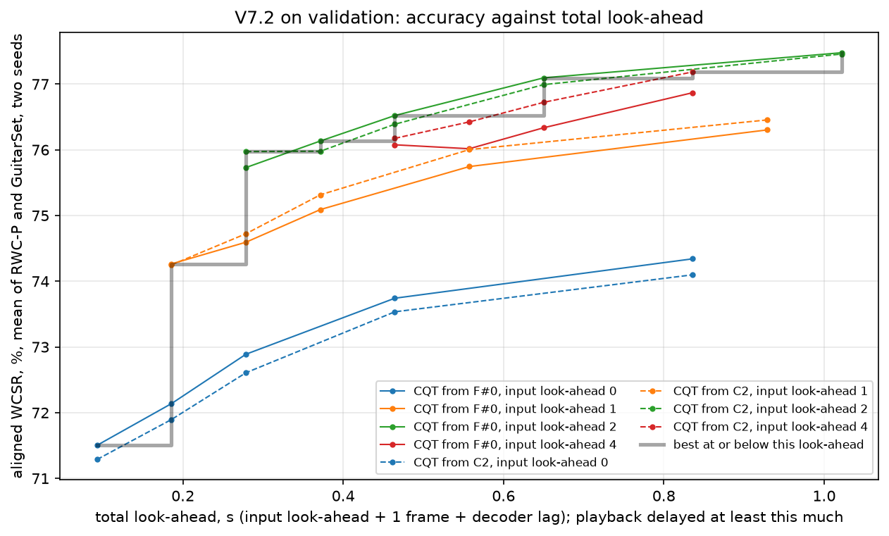

# V7.2: a short read-ahead with delayed playback

## Question

V7 and V7.1 showed that a system with no look-ahead loses most of its accuracy in the first half
second after a chord change: it has to hear a new chord before it can name it. The intended use is a
musician playing along with a recording whose playback is delayed (reports/v7_1.md, "The target
set-up"). With the playback delayed, the system may read a little past each frame and every label
still arrives together with the frame it describes. V7.2 asks: **what accuracy does each amount of
total look-ahead buy, and how should it be split between the input and the decoder?** It also tests
starting the CQT at C2 instead of F#0.

## Summary of the results

A quarter of a second is enough. Three results on validation (two seeds each):

1. **Input look-ahead is the lever.** Letting the network's window reach 2 frames past its frame
   raises the network alone from 71.50 % to 75.73 % aligned WCSR, for a total look-ahead of 0.28 s.
   That is V7's level (76.14 %), whose input read 1.6 s ahead. The gain sits where V7.1 lost:
   in the first 0.5 s after a chord change, 50 % of frames right become 66 to 70 % (RWC-P) and
   46 % become 58 to 60 % (GuitarSet). Beyond 2 frames the input adds little (4 frames: 76.08 %, a tie).
2. **The decoder adds the rest and removes flicker.** On top of 2 frames of input look-ahead, a
   fixed-lag Viterbi reaches 76.52 % at 0.46 s total and 77.09 % at 0.65 s, with 35 to 39 chord
   changes per minute instead of 57 (references: 28 to 31).
3. **Starting the CQT at C2 costs nothing.** At every input look-ahead the C2 grid ties the F#0 grid
   within the seed noise, with half the low notes' delay.

| Validation: best aligned WCSR % at each total look-ahead | s | WCSR | seed 0 / 1 | from |
|---|---:|---:|---|---|
| 1 frame | 0.09 | 71.50 | 71.45 / 71.56 | F#0, input 0, network alone (V7.1) |
| 2 | 0.19 | 74.26 | 74.52 / 74.01 | F#0, input 1, network alone |
| 3 | 0.28 | 75.97 | 76.17 / 75.78 | C2, input 2, network alone |
| 4 | 0.37 | 76.13 | 76.73 / 75.54 | F#0, input 2, fixed-lag lag 1 |
| 5 | 0.46 | 76.52 | 77.17 / 75.87 | F#0, input 2, fixed-lag lag 2 |
| 7 | 0.65 | 77.09 | 77.86 / 76.33 | F#0, input 2, fixed-lag lag 4 |
| 11 | 1.02 | 77.48 | 78.23 / 76.73 | F#0, input 2, fixed-lag lag 8 |

| Test, run once, the same frozen points (better seed of each) | s | RWC-P | GuitarSet | mean |
|---|---:|---:|---:|---:|
| 1 frame, network alone (V7.1) | 0.09 | 73.70 | 68.22 | 70.96 |
| 2, network alone | 0.19 | 76.85 | 70.25 | 73.55 |
| **3, network alone** | **0.28** | **78.66** | **71.90** | **75.28** |
| 5, fixed-lag lag 2 | 0.46 | 79.41 | 70.94 | 75.18 |
| 7, fixed-lag lag 4 | 0.65 | 80.07 | 71.32 | 75.70 |
| 11, fixed-lag lag 8 | 1.02 | 80.43 | 71.70 | 76.06 |

- [Setup](#setup)
- [How the evaluation avoids leakage](#how-the-evaluation-avoids-leakage)
- [Results on validation](#results-on-validation)
- [Findings (all from validation)](#findings-all-from-validation)
- [Test](#test)
- [Limitations](#limitations)
- [What the next version should look at](#what-the-next-version-should-look-at)
- [Reproduce](#reproduce)

## Setup

Everything is V7.1's (causal features with the 9-frame harmonic median, causal CRNN, V6's training,
V7's decoders) except two things:

    input look-ahead   the network's 15-frame window for frame t ends at t + a (V7.1: a = 0); a = 1, 2, 4,
                       one network trained per value (data_v7_2, train_v7_2)
    CQT grid           from F#0 (V7.1's cache: the network sees C1 to B6) or from F#1 (new cache: it sees
                       C2 to B7); C1's kernel reaches the network 6 frames late, C2's 3 frames

Three look-aheads, all in frames (1 frame = 93 ms):

- **Input look-ahead** a: how far past frame t the network's input reaches. Changing it means retraining.
- **Decoder lag**: how many frames the fixed-lag Viterbi waits before labelling frame t (V7). No retraining.
- **Total look-ahead** = input look-ahead + 1 + decoder lag: how long after frame t its label exists (the
  1 is the harmonic separation's STFT window, as in V7.1). The playback must be delayed at least this
  much, plus any lead time wanted for the label.

Example: input look-ahead 2 and decoder lag 2 give a total look-ahead of 5 frames (0.46 s). With the
recording played back 0.46 s late, the label of the frame that sounds at 10.00 s in the original is
ready at 10.46 s, exactly when the musician hears that frame.

Score: **aligned WCSR** (each label against the reference at the frame it describes), mir_eval majmin,
pooled per set, mean of RWC-P and GuitarSet. With delayed playback every label arrives on time, so the
delay is the cost and aligned WCSR the accuracy. Also reported: chord changes per minute.

The grid of networks: F#0 at input look-ahead 0 (V7.1, not retrained), 1, 2, 4; C2 at 0, 1, 2, 4;
two seeds each (14 new runs). Every network is decoded at every system, lag and p_self of V7's grids.
`scripts/v7_2_curve.py` keeps, for each total look-ahead, the point (grid, input look-ahead, system,
lag, p_self) with the best two-seed mean. A point counts as better than another only if both its seeds
beat both of the other's.

Tests: the window of frame t is t - 14 + a .. t + a; the network's output for frame t never reads a
column after t + a; feeding the columns one at a time (`streaming_v7_2.LookaheadStreamingCRNN`) gives
the whole-song posteriors; the causal features on the C2 grid pass V7.1's prefix check (no column reads
the future) and C2 waits 3 frames.

## How the evaluation avoids leakage

Same rule as V0 to V7.1: **test is scored once, never inspected.** The weights see RWC-P train and
GuitarSet comp train only. Every point of the curve (grid, input look-ahead, decoder, lag, p_self) and
its seed were chosen on validation and written into `configs/v7_2.yaml` (`frozen`) before
`run_v7_2.py --split test --freeze` ran once; only its summary numbers were read.

## Results on validation

**The networks** (network alone, aligned WCSR %, seed 0 / 1; offline frame Viterbi, two-seed mean;
chord changes per minute of the network alone):

| CQT from | input look-ahead | network alone | mean | offline frame Viterbi | changes / min |
|---|---:|---|---:|---:|---:|
| F#0 | 0 (V7.1) | 71.45 / 71.56 | 71.50 | 74.60 | 84 |
| F#0 | 1 | 74.52 / 74.01 | 74.27 | 76.45 | 72 |
| F#0 | 2 | 76.18 / 75.28 | 75.73 | 77.53 | 57 |
| F#0 | 4 | 76.06 / 76.09 | 76.08 | 77.28 | 50 |
| C2 | 0 | 71.90 / 70.67 | 71.29 | 74.31 | 81 |
| C2 | 1 | 74.11 / 74.38 | 74.25 | 76.52 | 75 |
| C2 | 2 | 76.17 / 75.78 | 75.98 | 77.72 | 60 |
| C2 | 4 | 76.66 / 75.69 | 76.18 | 77.62 | 51 |

V7 (V6 features, 1.6 s look-ahead in the input): network alone 76.14 %, offline frame Viterbi 77.04 %.
Training stopped at epochs 7 to 14 (12 to 19 run), 13 to 21 minutes per run.

**The curve** (best point at each total look-ahead, table above; all points in
`results/v7_2/val_curve.json`):



**Right after chord changes** (`scripts/v7_2_breakdown.py`): frame accuracy of the network alone, seed 0 / 1.

| CQT from, input look-ahead | RWC-P, first 0.5 s after a change | RWC-P, rest | GuitarSet, first 0.5 s | GuitarSet, rest |
|---|---:|---:|---:|---:|
| F#0, 0 (V7.1) | 52.4 / 50.8 | 80.0 / 79.6 | 44.9 / 46.8 | 75.0 / 75.9 |
| F#0, 1 | 63.2 / 60.1 | 80.2 / 80.6 | 54.4 / 54.2 | 76.2 / 76.2 |
| F#0, 2 | 70.1 / 66.6 | 81.2 / 81.2 | 59.7 / 57.9 | 76.2 / 75.8 |
| F#0, 4 | 71.9 / 69.7 | 79.1 / 82.5 | 63.2 / 59.1 | 76.0 / 75.4 |
| C2, 2 | 70.1 / 70.3 | 80.7 / 79.1 | 60.5 / 58.8 | 76.4 / 77.4 |
| C2, 4 | 72.9 / 72.1 | 81.3 / 80.3 | 60.8 / 60.8 | 75.8 / 75.3 |

V7 (centred input, 0.65 s of window past the frame): RWC-P 72.5 / 74.9 and GuitarSet 63.4 / 66.9 in
the first 0.5 s after a change.

## Findings (all from validation)

**1. Two frames of input look-ahead recover V7's accuracy.** The network alone gains 2.8 points with
1 frame of input look-ahead and 1.5 more with 2 (both steps meet the two-seed rule on the F#0 grid).
At a total look-ahead of 0.28 s it scores 75.7 to 76.0 %, the level of V7's network alone (76.14 %),
whose input read 1.6 s past each frame. A fourth of a second of look-ahead does what 1.6 s did.

**2. The gain is where V7.1 lost.** Away from chord changes nothing moves (RWC-P 80 to 81 %, GuitarSet
75 to 77 %). In the first 0.5 s after a change, 2 frames of input look-ahead take RWC-P from about 51
to 67 to 70 %, and GuitarSet from about 46 to 58 to 60 %. The network hears the first notes of the new
chord before it labels its first frame.

**3. Beyond 2 frames the input saturates.** 4 frames of input look-ahead tie 2 (76.08 against 75.73 %
on F#0, 76.18 against 75.98 % on C2; the two-seed rule is not met). Past a total look-ahead of 0.28 s
the best points all use 2 frames of input and spend the rest of the delay in the decoder.

**4. With a delay, the decoder helps again.** On V7.1's network the offline frame Viterbi added 3.1
points; with 2 frames of input look-ahead it still adds 1.8 (77.53 %), and a fixed-lag Viterbi gets
most of it in real time: +0.4 at lag 1, +0.8 at lag 2, +1.4 at lag 4 (77.09 % at 0.65 s total). It
also brings the chord changes per minute from 57 to 43 (lag 1), 39 (lag 2) and 35 (lag 4).

**5. The C2 grid ties the F#0 grid.** At every input look-ahead the two grids are within the seed noise
of each other (71.29 / 71.50, 74.25 / 74.27, 75.98 / 75.73, 76.18 / 76.08 %), and neither beats the
other with both seeds. The lowest octave and a half (F#0 to B1) does not carry chord information the
network needs, and dropping it halves the low notes' delay.

**Freeze.** The best point at each total look-ahead with the better of its two seeds (`configs/v7_2.yaml`,
`frozen`). For an application: 3 frames (0.28 s) with the network alone if flicker is acceptable, or 5
to 7 frames (0.46 to 0.65 s) with input look-ahead 2 and a fixed-lag Viterbi for steadier labels.

## Test

Run once, after the freeze, every frozen point with its seed. Aligned WCSR, %, and chord changes per
minute (RWC-P / GuitarSet):

| total look-ahead | s | point | RWC-P | GuitarSet | mean | changes / min |
|---:|---:|---|---:|---:|---:|---|
| 1 | 0.09 | F#0, input 0, network alone (seed 1) | 73.70 | 68.22 | 70.96 | 88 / 88 |
| 2 | 0.19 | F#0, input 1, network alone | 76.85 | 70.25 | 73.55 | 79 / 77 |
| 3 | 0.28 | C2, input 2, network alone | 78.66 | 71.90 | 75.28 | 65 / 63 |
| 4 | 0.37 | F#0, input 2, fixed-lag lag 1 | 78.89 | 70.52 | 74.70 | 47 / 42 |
| 5 | 0.46 | F#0, input 2, fixed-lag lag 2 | 79.41 | 70.94 | 75.18 | 41 / 37 |
| 6 | 0.56 | C2, input 4, fixed-lag lag 1 | 79.81 | 70.84 | 75.33 | 42 / 40 |
| 7 | 0.65 | F#0, input 2, fixed-lag lag 4 | 80.07 | 71.32 | 75.70 | 37 / 35 |
| 9 | 0.84 | C2, input 4, fixed-lag lag 4 | 80.44 | 71.38 | 75.91 | 35 / 34 |
| 10 | 0.93 | C2, input 1, fixed-lag lag 8 | 79.78 | 71.55 | 75.66 | 35 / 33 |
| 11 | 1.02 | F#0, input 2, fixed-lag lag 8 | 80.43 | 71.70 | 76.06 | 34 / 32 |

The test curve has the shape of the validation curve: the big step is the first 2 frames of input
look-ahead (70.96 to 75.28 %), then the decoder adds up to 0.8 points and halves the flicker. For
comparison, V7's frozen test run read 1.6 s ahead and scored 75.48 % with the network alone and 76.25 %
with the whole song.

## Limitations

- **Each point is one seed on test**, the better of two on validation, which flatters both its
  validation and its test score a little; neighbouring points differ by less than the seed noise.
- **The lag grid is sparse** (0, 1, 2, 4, 8 frames), so some total look-aheads (8, 12) have no point
  and others are reached by an odd mix; a denser grid would smooth the curve but not change its shape.
- **The features are still computed on the whole file**, proven causal by the prefix tests; the
  frame-by-frame feature extractor is not built yet.
- **Flicker** is lower but still above the reference (35 to 65 changes per minute against 28 to 31).
- **Two seeds**, the same 24 classes and data as V5 to V7.1.

## What the next version should look at

- **The operating point and the lead time with the musician in the loop**: the curve gives the accuracy
  for each delay; the delay a player accepts and how early a chord should appear are for listening tests.
- **A frame-by-frame feature extractor** (harmonic part on the last 9 STFT frames, CQT from a buffer of
  the last 0.53 s from C2, running level by histogram, tuning switch at 10 s), checked against the
  cached columns and timed against the 93 ms frame budget: the step before an application.
- **Flicker at short look-ahead**: a minimum segment duration on the network alone at 0.28 s, scored on
  aligned WCSR and changes per minute, against the fixed-lag Viterbi at the same delay.
- **The N class and sevenths**, still open since V5, on top of the C2 grid with 2 frames of input look-ahead.

## Reproduce

```bash
PYTHONPATH=src python -m pytest tests/test_data_v7_2.py tests/test_features_v7_2.py
PYTHONPATH=src python scripts/run_v7_2.py --split val --train --cqt-from F#0 --input-lookahead 2 --seed 0   # one cell
# every cell: F#0 at 1, 2, 4 and C2 at 0, 1, 2, 4, seeds 0 and 1 (F#0 at 0 is V7.1, results/v7_1/median9_seed*)
PYTHONPATH=src python scripts/v7_2_curve.py
PYTHONPATH=src python scripts/v7_2_breakdown.py
PYTHONPATH=src python scripts/run_v7_2.py --split test --freeze                                               # once
```
